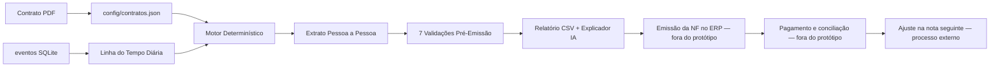

# O Fechamento do Mês — Medipreço

**Tese:** *a nota é o resultado de uma conta que qualquer pessoa consegue refazer.* O cálculo é 100% determinístico sobre o histórico de `eventos` (o "vídeo"), parametrizado por contrato em JSON; a IA atua apenas na explicação final em português, protegida por guardrail numérico.

---

## 1. O problema ilustrado pelo case (Aurora Logística, Out/2026)

| Visão | Data / Corte | Vidas | O que aconteceu |
|---|---|---:|---|
| Nota emitida (`NF-01306`) | Foto `26/10 09:00` (`data_processamento`) | **737** | Base antes da carga de desligamentos |
| Realidade no corte | `26/10` conhecido até `03/11` (`data_informada`) | **721** | Carga de `27/10 11:57` trouxe 19 saídas (16 com `data_informada <= 26/10`) |
| Base baixada pelo RH | Foto `31/10 23:59` (`data_processamento`) | **718** | 737 − 19 saídas processadas em `27/10` |

---

## 2. O que o repositório responde para cada área

| Área | Pergunta que vivia sem resposta | O que este repositório entrega |
|---|---|---|
| **Financeiro** | Como revisar 6 regras diferentes sem erro de planilha? | Motor único em Python + 7 validações que classificam bloqueios e avisos para revisão antes da emissão |
| **RH do cliente** | "Baixei 718 vidas e cobraram 737, por quê?" | Gera extrato CSV pessoa a pessoa com dias ativos, plano, regra e corte de conhecimento, para compartilhar com o RH |
| **Comercial** | "O que eu vender vai dar para cobrar?" | Catálogo declarativo em `config/contratos.json` com 8 parâmetros explícitos |
| **CS** | "Por que a nota subiu ou caiu este mês?" | A comparação histórica traz decomposição por causa; o resumo atual do CLI é genérico, e a explicação causal integrada ainda é evolução proposta |

---

## 3. Como funciona



**Escopo implementado:** o protótipo reconstrói a apuração, gera extratos e relatórios
e apresenta validações. Não emite NF, não acompanha pagamentos e não envia ajustes ao ERP.

* **Eixo 1 — Realidade (`data_informada`):** quando a pessoa entrou, trocou de plano ou saiu na empresa.
* **Eixo 2 — Conhecimento (`data_processamento <= conhecido_ate`):** o que o sistema da Medipreço já sabia até o momento da emissão. O protótipo sinaliza diferenças tardias para análise; aplicar crédito/débito na nota seguinte é um processo externo.

---

## 4. Os 6 contratos como configuração

Todos os contratos estão em `config/contratos.json`. **No código de produção (`medipreco/`), há zero `if` por nome de cliente** (verificável com `grep -rnE "Aurora|Bravo|Delta|Estrela|Faro|Cedro" medipreco/`, que retorna apenas o exemplo da docstring em `medipreco/__main__.py`).

| Cliente | Unidade | Método de contagem | Particularidade |
|---|---|---|---|
| **Aurora Logística** | `vida` | `foto_dia` (dia 26) | 2 planos (`Base` R\$ 7,50 / `Plus` R\$ 12,00) |
| **Bravo Tecnologia** | `titular` | `foto_dia` (dia 26 mês anterior) | Pré-pago R\$ 15,00; dependente grátis; compensação na NF seguinte |
| **Delta Benefícios** | `vida` | `qualquer_dia_ativo` (≥ 1 dia) | Tabela escalonada degrau total (R\$ 10 / R\$ 9 / R\$ 8) |
| **Estrela Indústria** | `vida` | `foto_dia` (dia 26) | Mínimo 500 vidas (R\$ 9,50); 2 CNPJs, NF única na matriz |
| **Faro Serviços** | `vida` | `pro_rata` (dias ativos / dias do mês) | R\$ 11,00 proporcional aos dias de vigência no mês |
| **Grupo Cedro** | `vida` | `pico` (simultâneo no grupo) | R\$ 8,00; rateio por CNPJ no dia do pico; 3 NFs |

---

## 5. Resultados nos dados do case (7 linhas de destaque, até `12/11/2026`)

*(Nota: outubro/2026 é **provisório**, pois a base foi extraída em `13/11/2026`. Equação aditiva: `Emitido + ΔUnid + ΔMét + ΔRelEm = Na Emissão` e `Na Emissão + ΔTard = Final`. **`ΔDegrau` é um subcomponente informativo de `ΔTard`/`ΔRelEm` e não deve ser somado novamente.** Tabela completa das 19 competências em `exemplos/comparacao_emitido_x_contrato.csv`.)*

| Cliente | Comp. | Emitido | ΔUnid | ΔMét | ΔRelEm | Na Emissão | ΔTard | ΔDegrau* | Final (12/11) | Erro % |
|---|---|---:|---:|---:|---:|---:|---:|---:|---:|---:|
| Bravo Tecnologia | 2026-09 | 7.485,00 | -2.505,00 | 0,00 | +15,00 | 4.995,00 | +15,00 | 0,00 | 5.010,00 | -33,07% |
| Aurora Logística | 2026-10* | 6.378,00 | 0,00 | 0,00 | -160,50 | 6.217,50 | 0,00 | 0,00 | 6.217,50 | -2,52% |
| Delta Benefícios | 2026-08 | 45.459,00 | 0,00 | 0,00 | 0,00 | 45.459,00 | +2.061,00 | 0,00 | 47.520,00 | +4,53% |
| Delta Benefícios | 2026-09 | 49.410,00 | 0,00 | +90,00 | 0,00 | 49.500,00 | -3.546,00 | -5.106,00 | 45.954,00 | -6,99% |
| Delta Benefícios | 2026-10* | 48.920,00 | 0,00 | +140,00 | -3.628,00 | 45.432,00 | 0,00 | -5.048,00 | 45.432,00 | -7,13% |
| Estrela Indústria | 2026-10* | 4.845,00 | 0,00 | 0,00 | 0,00 | 4.845,00 | -95,00 | 0,00 | 4.750,00 | -1,96% |
| Grupo Cedro | 2026-10* | 7.568,00 | 0,00 | +120,00 | 0,00 | 7.688,00 | 0,00 | 0,00 | 7.688,00 | +1,59% |

### Achados principais
* **Bravo Set/2026:** cobrou `499` vidas totais (R\$ `7.485,00`) em vez de `332` titulares na foto (-R\$ `2.505,00`); na emissão (`27/08`) havia `333` titulares (-R\$ `2.490,00`) e até `12/11` havia `334` (-R\$ `2.475,00`).
* **Aurora Out/2026:** foto `26/10` (`737`) vs. realidade `26/10` (`721`) vs. sistema `31/10` (`718`), explicada por 16 saídas retroativas na carga de `27/10`.
* **Delta Benefícios (efeito degrau + lote anulado):** no degrau total, `4.999 × R$ 10 = R$ 49.990` vs. `5.001 × R$ 9 = R$ 45.009` (uma vida a mais reduz a fatura em R\$ `4.981`). Em **Set/2026**, pela regra contratual (`≥ 1 dia`), havia **4.950** vidas conhecidas na emissão (`01/10`, R\$ `49.500,00`) e **5.106** após o lote tardio (`05/10`, R\$ `45.954,00`) — comprovável por SQL com `LEAD()` sobre `eventos` filtrando `data_processamento <= '2026-10-01 23:59:59'` vs. `'2026-11-12 23:59:59'`. Além disso, em `07/10` subiram `600` entradas erradas (estimativa de ~R\$ `5.400`/mês a R\$ `9,00`) desfeitas em `09/10` por `suporte_medipreco`.
* **Estrela Out/2026:** em `03/11` constavam `510` vidas (R\$ `4.845,00`), mas desligamentos tardios (`39` saídas e `7` entradas) derrubaram a realidade de `26/10` para `478`, acionando o mínimo de `500` (R\$ `4.750,00`) → crédito de **R\$ 95,00**.
* **Grupo Cedro Out/2026:** pico simultâneo foi **961** vidas (R\$ `7.688,00`), contra `946` na nota, `984` pessoas distintas e `1.080` na soma dos picos individuais por CNPJ (`126` pessoas trocaram de CNPJ no grupo).

---

## 6. Como rodar

Os testes e os exemplos do CLI usam a fixture sintética versionada em `tests/fixtures/base.sqlite`. A base completa do case não é publicada; para usá-la, coloque `base.sqlite` em `data/base.sqlite` (ver `data/README.md`). Requisito: **Python 3.9+** (testado em **Python 3.9.6**, zero dependências externas).

```bash
# 1. Rodar a suíte de testes (28 testes; usa a fixture incluída)
python3 -m unittest discover -s tests -v

# 2. Fechar um cliente e competência (gera extrato CSV e resumo no terminal)
python3 -m medipreco fechar --cliente "Grupo Cedro" --competencia 2026-10 --conhecido-ate 2026-11-03 --db tests/fixtures/base.sqlite

# 3. Gerar o fechamento completo (tabela comparativa, matriz de 28 notas e 25 extratos CSV)
python3 -m medipreco tudo --db tests/fixtures/base.sqlite
```

Saída real observada ao rodar o comando 2:
```text
=== Fechamento: Grupo Cedro | 2026-10 | conhecido até 2026-11-03 23:59:59 ===
- Tomador 33.718.402/0001-95: R$ 3.368,00 (421 linhas) -> saida/extratos/grupo_cedro_2026-10_33718402000195.csv
- Tomador 33.722.817/0001-32: R$ 2.864,00 (358 linhas) -> saida/extratos/grupo_cedro_2026-10_33722817000132.csv
- Tomador 33.727.529/0001-70: R$ 1.456,00 (182 linhas) -> saida/extratos/grupo_cedro_2026-10_33727529000170.csv
```

Arquivos gerados em `saida/` (e pré-gerados em `exemplos/`):
* `comparacao_emitido_x_contrato.csv`: comparativo das 19 competências emitidas com decomposição por causa e `erro_pct`.
* `matriz_alertas_28_notas.csv`: as 28 linhas de `notas_emitidas` avaliadas pelas 7 travas pré-emissão (`qtd_avaliada` = quantidade da nota emitida).
* `extratos/*.csv`: **25 extratos** (1 por CNPJ tomador × competência emitida, incluindo `2026-11` da Bravo).

---

## 7. Validações pré-emissão

Esta matriz é um **retroteste** sobre 28 notas já emitidas. As validações classificam
bloqueios e avisos para um fluxo preventivo; o protótipo não se conecta ao emissor
fiscal e não bloqueia notas no sistema de origem. Os extratos são produzidos para
revisão e compartilhamento; o protótipo não os envia ao cliente.

| Código da regra | Tipo | Exemplo observado no conjunto do case (`exemplos/matriz_alertas_28_notas.csv`) |
|---|---|---|
| `UNIDADE_VIDAS_EM_CONTRATO_TITULAR` | `bloqueio` | Bravo Set/2026 (`499` == total de vidas quando titulares = `332`) |
| `CARGA_ATIPICA_QUARENTENA` | `bloqueio` | Delta Out/2026 (carga `07/10` com `600` entradas e lag de até `1.010` dias) |
| `DIVERGENCIA_EXTRATO_NOTA` | `bloqueio` | Qualquer divergência entre soma das linhas do extrato e total da NF |
| `VARIACAO_MAIOR_10_PCT` | `aviso` | Bravo Set/2026 (`+55,5%` vs Ago) e Out/2026 (`-32,5%` vs Set) |
| `PROXIMO_LIMITE_FAIXA` | `aviso` | Delta Ago (`5.051`, `1,02%` de `5.000`) e Set (`4.941`, `1,18%`); em Out (`4.892`, `2,16%`) não dispara na nota emitida |
| `MINIMO_GARANTIDO_ACIONADO` | `aviso` | Estrela Out/2026 (`478 < 500` vidas) |
| `DESLIGAMENTO_FORA_SLA` | `aviso` | Premissa operacional de `7` dias corridos (baseada nos `5` dias úteis da Cláusula 5.3 da Estrela); na Delta (sem SLA contratual, apenas Cláusula 7.3 de exatidão da base), atua como alerta operacional de atraso |

---

## 8. Onde entra a IA e onde não entra

* **Onde NÃO entra:** nenhuma função de cálculo em `medipreco/timeline.py`, `medipreco/contratos.py`, `medipreco/extrato.py` ou `medipreco/validacoes.py` chama IA.
* **Onde entra (`medipreco/explicador.py`):** recebe apenas o resumo numérico estruturado do motor (sem nomes de pessoas) para redigir a explicação em português.
* **Filtro numérico (`validar_cifras_no_texto`):** descarta respostas com cifras que não aparecem nos dados de entrada. Ele não valida se a explicação está semanticamente correta; a revisão humana continua necessária.
* **Dados enviados ao provedor:** com `OPENAI_API_KEY`, o CLI envia cliente, competência, valor total e corte de conhecimento à API OpenAI. Não envia IDs individuais nesse fluxo; esses dados ainda podem ser confidenciais e exigem aprovação antes de uso em produção.
* **Modo offline:** funciona 100% sem chave de API; para ativar OpenAI, defina `OPENAI_API_KEY` no ambiente.

---

## 9. Decisões, premissas declaradas e alinhamentos sugeridos

### Decisões e premissas
1. **Saída vale a partir da `data_informada` (premissa):** pessoa fica inativa já no dia da saída; impacta 2 vidas em Aurora `26/10` (`721` vs `723`).
2. **Corte de conhecimento na emissão (decisão):** diferenças que chegarem depois entram como crédito/débito na nota seguinte, evitando cancelar NF já emitida.
3. **Lote de `07/10` da Delta anulado (decisão):** `saida` de `suporte_medipreco` na mesma `data_informada` da `entrada` anula o par sem hardcode de cliente/data.
4. **Bravo Cláusula 4.4 (premissa):** "titulares efetivamente ativos" = titulares reais no dia 26 do próprio mês de referência (já conhecido antes da NF seguinte).
5. **Faro pró-rata (premissa):** divisor = dias reais do mês civil; arredondamento no total da nota com centavos distribuídos pelo maior resto.
6. **Delta faixas (premissa):** leitura de degrau total, coerente com `notas_emitidas`.
7. **Cedro pico e rateio (decisão):** pico simultâneo de pessoas distintas no grupo; empate = primeiro dia; rateio pelo dia do pico; resto ao maior resto.

### Alinhamentos sugeridos com Jurídico / Comercial
* **Delta (tabela escalonada):** migrar de degrau total para **faixa progressiva** em aditivo, eliminando o incentivo perverso de pagar menos ao subir de `5.000` para `5.001` vidas, e incluir cláusula de anulação para cargas erradas.
* **Grupo Cedro (redação):** explicitar em aditivo que "número máximo alcançado no mês" refere-se ao **pico simultâneo diário** do grupo e definir o critério de rateio.
* **Data de saída (todos os contratos):** padronizar em contrato que a vigência cessa no próprio dia da `data_informada` de desligamento.

---

## 10. O que ficou de fora e por quê (roadmap)

* **Campo `anulado_por_evento_id` no banco:** hoje o pareamento é heurístico por `suporte_medipreco`; precisa de coluna explícita no schema em produção.
* **Extrator de contratos por LLM:** leitura automática de novos PDFs para sugerir `config/contratos.json` com aprovação humana.
* **Copiloto conversacional completo e integração fiscal (NF-e/boleto):** dependem de autenticação do portal e API do emissor fiscal.

---

## 11. Estrutura do repositório

```text
.
├── .gitignore
├── config/contratos.json
├── data/
│   └── README.md
├── docs/
│   ├── PROPOSTA.md
│   └── RELATO_IA.md
├── exemplos/
│   ├── comparacao_emitido_x_contrato.csv
│   ├── matriz_alertas_28_notas.csv
│   └── extratos/ (25 CSVs)
├── medipreco/
│   ├── __init__.py
│   ├── __main__.py
│   ├── comparacao.py
│   ├── contratos.py
│   ├── explicador.py
│   ├── extrato.py
│   ├── timeline.py
│   └── validacoes.py
├── tests/
│   ├── fixtures/
│   │   ├── README.md
│   │   └── base.sqlite
│   ├── test_comparacao.py
│   ├── test_contratos.py
│   ├── test_extrato.py
│   ├── test_timeline.py
│   └── test_validacoes_e_ia.py
└── README.md
```

* Proposta completa: [docs/PROPOSTA.md](docs/PROPOSTA.md)
* Relato de uso de IA: [docs/RELATO_IA.md](docs/RELATO_IA.md)
